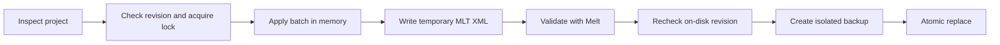

# Technical reference

[Shotcut MCP](../README.md) · [Installation](installation.md) · [Workflow and examples](workflows.md)

Detailed capabilities, MCP tools, export presets, and runtime policy for client authors,
integrators, and users who need more control.

[Features](#features) · [Tools](#mcp-tools) · [Rendering](#rendering) · [Configuration](#configuration) · [Safety](#transactional-safety) · [Limitations](#limitations)

## Features

| Area | Capabilities |
| --- | --- |
| Tracks | Add, remove, rename, reorder, lock, hide, mute, and configure composition for video and audio tracks |
| Timeline | Add, duplicate, replace, split, and move media or generators using revision-scoped item references and transaction-local aliases; insert gaps, overwrite, remove ranges, trim, roll, slip, slide, and apply constant or variable speed |
| Transitions | Shotcut-compatible nested crossfades with selectable MLT video services and optional audio mixing |
| Effects | Animate clip pan, zoom, rotation, opacity, and volume with structured creative values; add, update, reorder, and remove native MLT filters on a clip, track, or project when lower-level control is needed |
| Generators | Color, dynamic text, tone, and noise |
| Project data | Profiles, semantic SDR/HLG/PQ workflows, notes, editable markers, subtitles, assisted hash-based relinking, and unknown XML preservation |
| Review | Compatibility doctor, source-quality and color analysis, inspection, read-only edit plans/diffs, MLT validation, preview batches, and atomic contact sheets |
| Export | Atomic chapter files and restart-resilient full/range/marker renders with ETA/history, safe presets, and hardware-encoder smoke detection |
| Recovery | Per-project isolated backups, revision conflict detection, backup listing, and validated restore |

## MCP tools

| Tool | Purpose |
| --- | --- |
| `shotcut_status` | Discover Shotcut, Melt, FFmpeg, and FFprobe and report versions |
| `shotcut_doctor` | Verify the Shotcut/MLT stack, RNNoise, FFmpeg analyzer availability, and path policy |
| `shotcut_capabilities` | Return the complete edit catalog and context, or one focused operation schema and example |
| `discover_media` | Find media files in a folder with revision-aware pagination and optional compact metadata |
| `probe_media` | Inspect streams, codecs, dimensions, frame rate, audio, and duration |
| `analyze_media_quality` | Measure silence, black frames, freezes, interlacing, and EBU R128 loudness |
| `inspect_project` | Inspect saved project state with revision-scoped item references and bounded track, interval, and page selection |
| `diagnose_color_workflow` | Report normalized media color facts and supported HDR workflow constraints |
| `diagnose_missing_media` | Search bounded roots by Shotcut hash/basename and optionally render a visual candidate sheet |
| `plan_project_edit` | Validate stable-reference operations and preview their snapshot/XML diff without changing the project |
| `create_project` | Create a Shotcut-compatible multitrack MLT project |
| `edit_project` | Apply up to 500 timeline operations using stable item references and aliases in one validated transaction, then summarize and visually review relevant changes |
| `list_mlt_services` | List locally available MLT filters, transitions, producers, consumers, or links |
| `describe_mlt_service` | Return metadata for one installed MLT service |
| `validate_project` | Report first-frame Melt `valid` status and dependency-complete `ready` status |
| `render_preview` | Render a selected frame to PNG, with optional managed output |
| `render_preview_batch` | Render up to 64 exact frames with bounded per-output outcomes |
| `render_contact_sheet` | Render exact or evenly sampled frames into one atomic review image |
| `render_review_clip` | Render a managed preview of up to 30 seconds with motion and audio for reviewing pacing and transitions |
| `detect_hardware_encoders` | Distinguish built, advertised, and smoke-tested FFmpeg hardware encoders |
| `open_in_shotcut` | Open a project or media path in the Shotcut GUI |
| `start_render` | After explicit export intent or approval, snapshot one revision and start a durable full-project, range, or marker render |
| `export_marker_chapters` | Atomically export point markers as Shotcut chapter text |
| `render_status` | Monitor meaningful progress to a terminal state and return media plus exact editable-project artifacts on completion |
| `list_render_jobs` | Return bounded newest-first render history with cursor pagination |
| `cancel_render` | Cancel a supervised render, including after an MCP server restart |
| `list_project_backups` | List retained project backups and revisions |
| `restore_project_backup` | Validate and atomically restore a selected backup |

Clients receive full JSON schemas, operation examples, revision requirements, stable item-reference
guidance, and animation contracts at runtime. Integrators can consult the
[behavioral specification](spec.md); the published tool schemas remain the source of truth
for request parameters.

## Project inspection

`inspect_project` returns a bounded view of saved state. Use `track` to select a track by name or ID and `in_frame`/`out_frame` to select items overlapping a zero-based inclusive timeline interval. `offset` and `limit` select pages, with a default limit of 100 and a maximum of 500. Pass the inspected `expected_revision` on later pages to reject a changed project instead of combining revisions.

`pagination` reports `detail`, `offset`, `limit`, collection `totals`, `next_offset`, and the active `track_id`, `in_frame`, and `out_frame` filters. Follow `next_offset` until it is null. The shared offset applies independently to the flat list of matching timeline items, track metadata, and each top-level collection. Track metadata also accompanies every returned item, so a response can contain up to twice `limit` tracks. An empty track item list on one page does not mean that the track is empty. Track and frame filters apply to tracks/items; other collections, including markers, filters, and resources, remain project-wide.

The default `detail: "full"` keeps nested filter lists and their properties with each returned track or item. `detail: "summary"` preserves identifiers and timing while clearing notes, captions, property bags, and subtitle text. Use summary mode or a smaller page when a detailed inspection exceeds the message budget.

Successful create and edit calls normally include the updated project; restores return revision, backup, and validation details. If a successful response would exceed the MCP message budget, the server returns a compact receipt with the tool's success flag (`created`, `edited`, or `restored`) set to true, the saved `revision`, `result_truncated: true`, and `recommended_tool: "inspect_project"`. Paths, backup details, and operation results are included only when they fit. Reinspect the relevant scope to obtain item references for the new revision; do not repeat the committed mutation because its snapshot was omitted.

## Media discovery

`discover_media` lists known video, audio, and image extensions in `folder_path`. It searches the immediate folder by default; set `recursive: true` for subfolders. Pages default to 50 files and accept up to 200. Reuse the returned `next_cursor` with the same search arguments; a changed listing requires restarting pagination. Extension-based kinds are a discovery hint, not proof that a file can be decoded.

Set `include_metadata: true` to probe the current page for compact duration, dimensions, frame rate, and audio facts. A failed or timed-out probe remains a per-file `probe_error` so other candidates stay usable. Traversal applies path policy, skips directory symlinks and junctions, and is bounded by 20,000 entries and 16 levels. Traversal and metadata probing share a 30-second budget. Narrow the folder when a scan limit is reached; use `probe_media` when you need complete stream details for a selected file.

## Visual and audio review

Use `render_preview` for one exact frame, `render_preview_batch` for several separate PNGs, and `render_contact_sheet` for one comparison image. Omit the output path on a single preview or contact sheet to use managed storage; small images can be displayed directly by the client.

Use `render_review_clip` to assess movement and sound. Supply zero-based inclusive `in_frame` and `out_frame` values within the timeline and optionally the inspected `expected_revision`. The range must fit within 30 seconds. The result is a managed H.264/AAC MP4 at no more than 1280×720, preserving display aspect ratio without upscaling. This synchronous preview has a 180-second timeout and a 32 MiB output limit, and returns a media path/URI for clients that can display local video. If the output is too large, request a shorter range. It is a temporary review artifact: each successful review for the same project replaces its previous managed clip. Use `start_render` for a persistent delivery.

## Rendering

| Use | Presets |
| --- | --- |
| Delivery | `h264-high`, `h264-web`, `hevc`, `av1` |
| HDR delivery | `hdr-hlg-hevc`, `hdr-pq-hevc` |
| Intermediate | `prores`, `dnxhd` |
| Audio | `audio-flac`, `audio-mp3` |

Request a complete project, a precise frame range, or a named range marker. See the
[workflow](workflows.md#recommended-workflow) for export authorization and progress updates.
The durable supervisor lets you check progress or cancel after the MCP client restarts.

`start_render` accepts the inspected `expected_revision` and captures the saved project once into a
sibling `<project>.render-<job_id>.mlt` file before the worker starts. Melt reads only this immutable
snapshot. When `render_status` reaches `completed`, modern MCP clients receive resource links for
both the rendered media and that exact editable project; older clients receive both canonical paths
and artifact metadata in text.

HDR presets use verified 10-bit software encoders; codec and hardware availability still depend on
the local build. Preview and final outputs are written transactionally and replace their destination
only after the new file completes successfully.

## Configuration

Common Shotcut installations are detected automatically, so most users can skip this section.
Administrators and client integrators can override discovery or tighten runtime policy when needed:

| Environment variable | Purpose |
| --- | --- |
| `SHOTCUT_PATH` | Shotcut application |
| `SHOTCUT_MELT_PATH` | Melt executable |
| `SHOTCUT_FFMPEG_PATH` | FFmpeg executable |
| `SHOTCUT_FFPROBE_PATH` | FFprobe executable |
| `SHOTCUT_MCP_ALLOWED_ROOTS` | Optional `PATH`-separator list of canonical roots available to MCP tools |
| `SHOTCUT_MCP_REQUIRE_ABSOLUTE_PATHS` | Set to `1` to reject relative tool paths |
| `SHOTCUT_MCP_ALLOW_NETWORK_RESOURCES` | Set to `1` to allow HTTP/RTSP/etc. resources embedded in projects |
| `SHOTCUT_MCP_ALLOW_UNSAFE_CONSUMER_PROPERTIES` | Set to `1` to allow arbitrary consumer properties and sidecar formats |
| `SHOTCUT_MCP_MAX_WORKERS` | Concurrent MCP tool requests, clamped to 1–8 (default 4) |
| `SHOTCUT_MCP_MAX_PENDING` | Maximum in-flight tool requests or legacy batch items, clamped to 1–256 (default 32) |
| `SHOTCUT_MCP_MAX_PROJECT_BYTES` | Maximum saved MLT project size, clamped to 1–512 MiB (default 128 MiB) |
| `SHOTCUT_MCP_MAX_MESSAGE_BYTES` | Maximum inbound or outbound newline-delimited MCP message size, clamped to 1 KiB–16 MiB (default 4 MiB) |
| `SHOTCUT_MCP_MAX_INLINE_IMAGE_BYTES` | Maximum preview image embedded in an MCP result, clamped to the message budget (default 1 MiB; `0` disables) |

Network resources and unsafe consumer properties are denied by default. These variables are
administrator policies: tools cannot override them per request. `shotcut_status` and
`shotcut_doctor` report the active policy.

## Transactional safety

Revisions use SHA-256 and edits acquire a per-project `.shotcut-mcp.lock`. The 20 most
recent backups are retained in an isolated project namespace. Use `list_project_backups`
and `restore_project_backup` for recovery.

Existing preview and render destinations are rechecked for concurrent changes before atomic
promotion. Render snapshot ownership is described under [rendering](#rendering); startup
failures are covered in [troubleshooting](installation.md#troubleshooting-and-recovery).

## Limitations

- The MCP edits the latest project state saved to disk; it cannot see unsaved GUI changes.
- Unknown MLT XML is preserved, but edits are rejected when a target cannot be identified safely.
- Third-party filters, GPU/OpenGL services, codecs, and fonts vary by Shotcut installation.
- Quality analysis depends on filters present in the installed FFmpeg build. Checks run
  independently and report `unavailable` or `not_applicable` instead of failing the whole analysis.
- Speed maps accept wholly forward or wholly reverse non-zero ramps. Zero-crossing ramps and
  third-party/ambiguous chain links remain rejected.
- Replacing a speed map retains its selected source interval, including after trims or splits.
  Maps created by older versions without original source bounds, or changed outside the owned
  mapping, must be rebuilt from the original clip before replacement. Use a backup when needed;
  the server leaves the project unchanged when it cannot establish the source range safely.
- The tested MLT timeremap can return an invalid image when negative-speed integration lands
  on source frame zero. Such maps are rejected with `speed_map_reverse_boundary_unsupported`;
  no source frames are silently removed and no speed values are perturbed. For constant reversal,
  use `set_clip_speed`; otherwise choose a source range that stays above zero. This boundary needs
  an upstream MLT fix before it can be included in the verified interface.
- Ripple trim can affect only the target track or every unlocked track. Locked tracks are left
  unchanged, and a cross-track removal that intersects a transition is rejected rather than
  rewired speculatively.
- Changing project FPS preserves recognized timeline and marker frame numbers; it does not
  automatically retime the creative edit.
- If the dedicated render supervisor itself is forcibly killed while Melt survives, the job is
  reported as `orphaned` and its temporary output is retained rather than guessed at or promoted.
